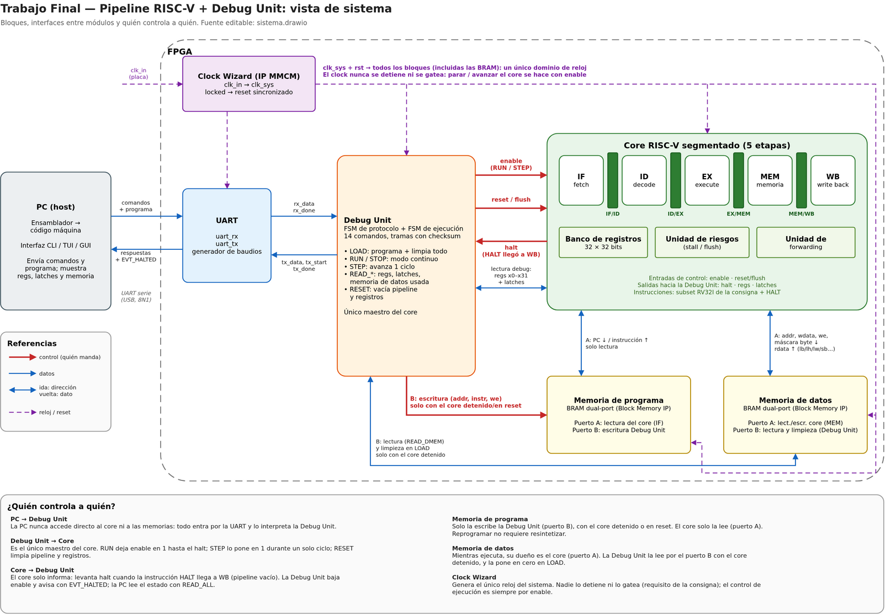

# Arquitectura de Computadoras

Trabajos prácticos de **Arquitectura de Computadoras** (FCEFyN, UNC).

Se desarrollan en Verilog los bloques de un procesador, implementados y verificados
sobre una **Basys 3** (Artix-7 `xc7a35tcpg236-1`) con **Vivado**. Todo converge en el
trabajo final: un **procesador RISC-V segmentado de 5 etapas** (IF, ID, EX, MEM, WB)
con una **Debug Unit** por UART y una interfaz en la PC para programarlo y observarlo.

## Estado

El trabajo final está implementado y probado en la placa:

- **Procesador**: RV32I (el subset de la consigna más `halt`) en 5 etapas, con forwarding,
  un ciclo de stall por carga-uso y saltos resueltos en EX con flush
  ([`docs/spec/pipeline.md`](docs/spec/pipeline.md)).
- **Debug Unit**: carga de programa por UART sin resintetizar, ejecución continua y paso a
  paso con `enable` (el reloj nunca se toca), y volcado de registros, latches y memoria de
  datos usada ([`docs/spec/protocolo_debug.md`](docs/spec/protocolo_debug.md)).
- **Reloj**: 92 MHz con el Clock Wizard, la máxima frecuencia que cumple timing
  ([`docs/timing/`](docs/timing/README.md)).
- **Verificación**: regresión en xsim con 39 programas y 27 testbenches, 39 mutantes del
  RTL, y en la placa 22 de 22 programas contra el resultado esperado y el modelo de
  referencia ([`docs/spec/verificacion.md`](docs/spec/verificacion.md)).

El informe final está en [`docs/informe/informe_final.pdf`](docs/informe/informe_final.pdf) (fuente en LaTeX en [`docs/informe/`](docs/informe/README.md)).

## Integrantes

- Costamagna, Matías
- Moreyra, Julián

## Estructura

```
rtl/                     Diseño sintetizable
├── common/              alu, banco de registros, generador de inmediatos, reset_sync y riscv_defs.vh
├── peripherals/uart/    UART: baud generator, tx, rx, FSM y buffers del TP2, y uart (la de la
│                        Debug Unit, con FIFO de recepción)
├── debug/               Debug Unit (comandos por UART, lectura de regs/latches/memoria)
├── pipeline/            Etapas y registros de segmentación (IF/ID/EX/MEM/WB)
├── control/             Unidad de control, forwarding, detección de riesgos
└── memory/              Memoria de programa (escribible por UART) y de datos
ip/                      Scripts Tcl que generan los IP cores (Clock Wizard, BRAM)
fpga/                    Un directorio por diseño: top.v + basys3.xdc
├── tp1_alu/
├── tp2_uart/
└── riscv_basys3/        Diseño del trabajo final
tb/
├── unit/                Un testbench por módulo
└── integration/         pipeline_tb: banco incremental, etapa por etapa y core completo
sw/                      Programas en ensamblador (con HALT) y su resultado esperado
tools/
├── assembler/           Ensamblador propio (rvasm): .s -> .hex/.bin/.coe/.lst
├── isasim/              Modelo de referencia: ISA y pipeline ciclo a ciclo
└── debugger/            Cliente del protocolo, debugger de texto y prueba en placa
scripts/                 Proyecto de Vivado, regresión, mutantes, timing y barrido de frecuencias
docs/
├── spec/                ISA soportada, protocolo de debug, diseño del pipeline
├── decisiones/          Una nota por decisión de diseño y su porqué
├── timing/              Camino crítico, skew, frecuencia elegida, reportes de Vivado
├── diagramas/
├── capturas/            El debugger y la comparación con el modelo, en la placa
├── informe/             Informe final (LaTeX)
└── tps/                 Informes de TP1, TP2, ...
```

## Diagrama en bloques del Sistema



## Abrir el proyecto en Vivado

El proyecto de Vivado (`.xpr`) **no se versiona**: se regenera desde las fuentes.

1. En Vivado: **Tools > Run Tcl Script...** y elegir `scripts/create_project.tcl`
   (por defecto crea `riscv_basys3`).
2. Para otro diseño, en la Tcl Console:
   ```tcl
   set DESIGN tp2_uart
   source <ruta-al-repo>/scripts/create_project.tcl
   ```
3. El proyecto queda en `build/vivado_<diseño>/`, carpeta ignorada por git.

Al agregar o mover archivos `.v` en `rtl/`, volvé a correr el script (o usá
*Add Sources* apuntando a la carpeta). El código siempre se edita en el repo, no
dentro de la carpeta `build/`.

## Usar el procesador

Con el bitstream de `riscv_basys3` en la placa y Python 3.11 o más nuevo:

```sh
pip install -r tools/debugger/requirements.txt
python tools/debugger/debugger.py --port COM8 --prog sw/demo/demo_datos.s
```

Conexión, teclas y problemas frecuentes en [`tools/debugger/README.md`](tools/debugger/README.md);
los programas de demostración y su guion, en [`sw/demo/`](sw/demo/README.md).

## Flujo de trabajo

- `master` siempre debe sintetizar y simular sin errores.
- El trabajo va en ramas `feature/<tema>` o `fix/<tema>` y entra por pull request
  revisado por el otro integrante.
- Prefijos de commit: `rtl:`, `tb:`, `sw:`, `tools:`, `docs:`, `chore:`.
- Cada hito se marca con un tag (`tp1`, `tp2`, `pipeline-v1`, ...).
- Antes de escribir un módulo se documenta su interfaz en `docs/spec/`; toda decisión
  de diseño va en `docs/decisiones/`.

## Hoja de ruta

1. [x] TP1: ALU
2. [x] TP2: UART
3. [x] Especificación: ISA, protocolo de debug, diagrama del pipeline (`docs/spec/`)
4. [x] Ensamblador (`tools/assembler/`)
5. [x] Etapas del pipeline + registros de segmentación
6. [x] Forwarding y detección de riesgos
7. [x] Memoria de programa por UART + Debug Unit
8. [x] Interfaz de debug en la PC
9. [x] Integración, análisis de camino crítico y Clock Wizard
10. [x] Informe final y presentación
