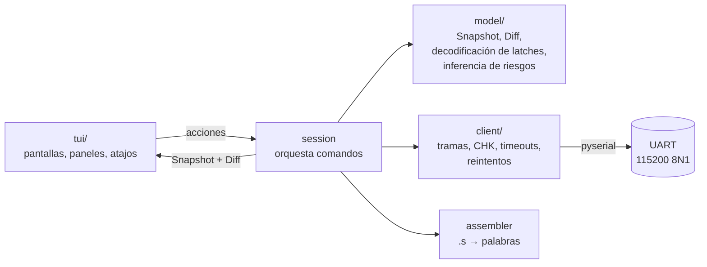
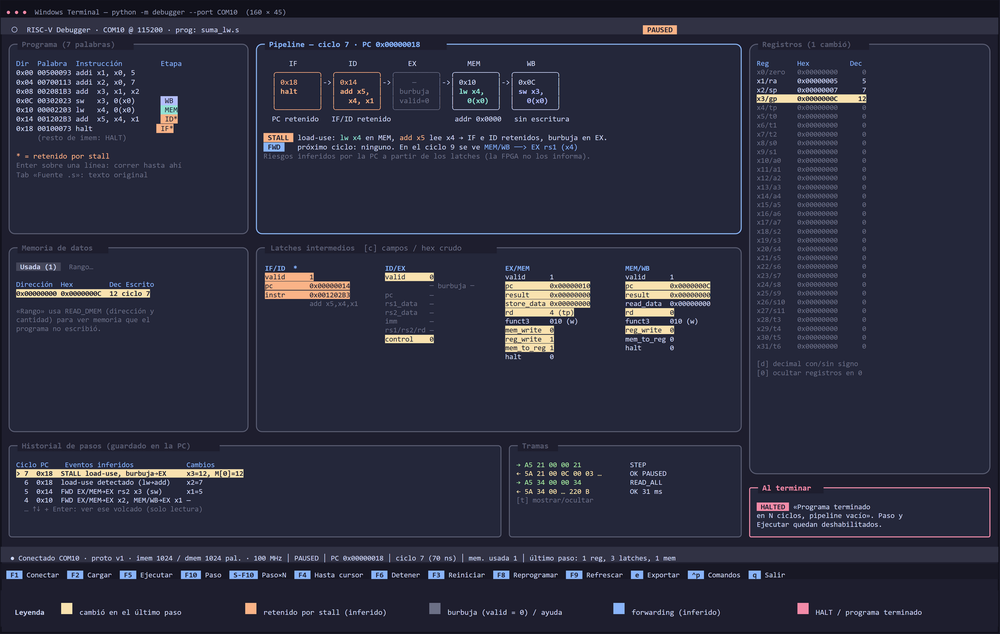
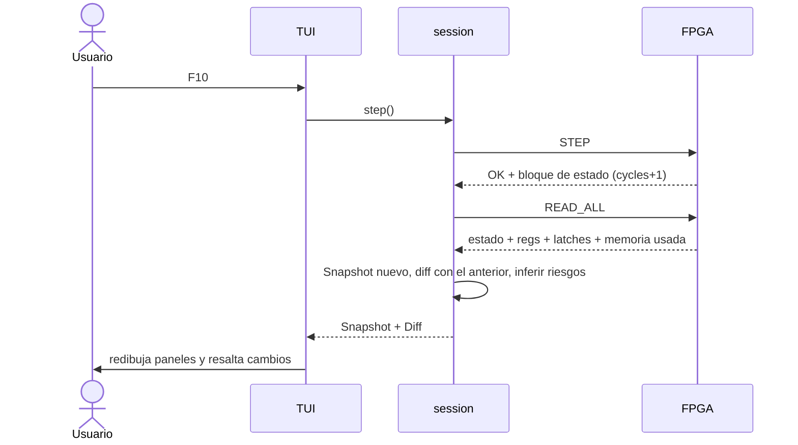

# Interfaz de la PC (debugger)

Cómo se ve y cómo se usa el programa de la PC que carga, ejecuta y observa el procesador por
la Debug Unit. Empezó como el boceto previo a programarlo; la I-52 lo implementa en
`tools/debugger/` (decisión [040](../decisiones/040_interfaz-de-usuario.md)) y la I-53 completa la
vista del pipeline (decisión [043](../decisiones/043_vista-del-pipeline.md)).

| | |
|---|---|
| **Tipo** | TUI (interfaz de texto a pantalla completa) con [Textual](https://textual.textualize.io/) — ver [decisión 008](../decisiones/008_interfaz-pc.md) |
| **Estado** | aceptada. Puntos abiertos en §7 |
| **Depende de** | [`protocolo_debug.md`](protocolo_debug.md) (comandos y bloques), `pipeline.md` (campos de los latches), [`isa.md`](isa.md) (desensamblado) |
| **Boceto** | [`interfaz.drawio`](../diagramas/interfaz.drawio) / [`interfaz.png`](../diagramas/interfaz.png) |

## 1. Arquitectura del software

| Capa | Depende de Textual | Responsabilidad |
|---|---|---|
| `client` | No | Arma y valida tramas (`protocolo_debug.md` §2), timeouts y reintentos (§5), despacha `EVT_HALTED`. Un método por comando: `info()`, `load(words)`, `step()`, `read_all()`, … |
| `model` | No | `Snapshot` = bloque de estado + registros + latches + memoria usada de un instante. `diff(prev, cur)` dice qué cambió. Decodifica los latches en campos y deduce stalls y forwarding (§4.3). |
| `session` | No | Secuencias de comandos (paso = `STEP` + `READ_ALL`), historial de volcados, máquina de estados de qué controles están habilitados. |
| `tui` | Sí | Solo dibuja y traduce teclas a acciones de `session`. El puerto se lee en un *worker* en hilo (`@work(thread=True)`) que publica mensajes a la app. |

Así el cliente se testea con las tramas de ejemplo del protocolo sin terminal, y el modelo de
referencia (I-16) y los tests de integración lo usan sin levantar la TUI.

Implementación (I-52 e I-53, decisiones [040](../decisiones/040_interfaz-de-usuario.md) y
[043](../decisiones/043_vista-del-pipeline.md)):

| Capa | Archivo | Qué tiene |
|---|---|---|
| `client` | `rvdebug/protocol.py`, `rvdebug/client.py` | El cliente del protocolo (I-50) |
| `model` | `rvdebug/model.py` | `Snapshot` (volcado de `READ_ALL` y el último `READ_DMEM`), nombres ABI y formato hex/decimal. `Snapshot.fields`: los latches campo por campo, con la tabla de `isasim.latches`. `word_at`: la palabra de una dirección según lo cargado. `diff`: qué cambió entre dos volcados |
| `model` | `rvdebug/hazards.py` | `analyze`: las cinco etapas y los riesgos inferidos de un volcado (§4.3) |
| `session` | `rvdebug/session.py` | `Session`: un método por control, cada uno termina con `READ_ALL`; `enabled()` con la tabla de §3. `history`: un renglón por volcado con su `diff` y su análisis. `run_to`: F4 |
| `tui` | `rvdebug/tui/` | `DebuggerApp`, paneles y modales. Se arranca con `python tools/debugger/debugger.py [--port …] [--prog …]` |

Cada acción que usa el puerto corre en un worker de Textual en un hilo. `RUN` es un worker aparte
que espera el final de a 0,5 s y manda `STATUS` entre espera y espera; mientras tanto, `STOP`,
`RESET` y `LOAD` corren en otro worker (el cliente serializa el puerto con un lock).

## 2. Pantalla principal

El boceto muestra el **ciclo 7** del programa de ejemplo, justo después de un `STEP`, con un
stall por load-use (`lw x4` seguido de `add x5, x4, x1`). Tamaño mínimo de la terminal:
**172 × 45**: es lo que ocupan Programa, los cuatro latches en columnas y Registros
(decisión [045](../decisiones/045_pantalla-sin-historial-y-latches-en-columnas.md)). Con
menos, el panel de latches se desplaza a lo ancho. El boceto todavía tiene el panel de
historial y los latches de a dos: la tabla de abajo manda.

| Panel | Contenido | Fuente (comando) |
|---|---|---|
| Encabezado | Puerto, baudrate, archivo cargado y **estado del core** (`NO_PROG`, `READY`, `RUNNING`, `PAUSED`, `HALTED`) con un color por estado. Advertencia si hay algún aviso de acceso (`imem_fault`, `dmem_oob`, `dmem_misaligned`: el programa accedió fuera de rango o desalineado, [`memoria.md`](memoria.md) §6) | Bloque de estado (`flags`) |
| **Programa** | Dirección, palabra en hex, instrucción desensamblada y una etiqueta con la **etapa** en la que está cada instrucción (IF, ID, EX, MEM, WB; `*` si está retenida). Pestaña «Fuente .s» con el texto original y sus comentarios. | Lo que se envió con `LOAD` + PC de cada latch |
| **Pipeline** | Cinco cajas IF → WB con PC e instrucción de cada etapa. Burbujas en gris con su causa (stall, flush, HALT, reset), etapas retenidas en naranja, HALT en rojo. Debajo de cada caja, qué hace (PC retenido, `lee M[…]`, `x3 ← 12`). Debajo, los riesgos inferidos con la explicación (§4.3). | `pc` del estado (IF) + `pc` y `valid` de cada latch. La instrucción de ID sale de `IF/ID.instr`; la de las demás etapas, de lo que se envió con `LOAD` en ese `pc` (los latches no llevan la palabra, decisión [043](../decisiones/043_vista-del-pipeline.md)) |
| **Latches intermedios** | IF/ID, ID/EX, EX/MEM y MEM/WB campo por campo, con los nombres de `pipeline.md`, **uno por columna** en el orden del pipeline (debajo de las cajas IF → WB). Cada columna tiene el ancho de su renglón más largo posible, así no cambia entre un paso y otro. Tecla `c`: alterna entre campos y las palabras de 32 bits crudas. | `READ_LATCHES` (dentro de `READ_ALL`) |
| **Registros** | Los 32 registros con nombre ABI (`x1/ra`, `x2/sp`, …), hex y decimal. Los que valen 0 en gris. Tecla `d`: decimal con o sin signo; `0`: ocultar los que valen 0. 36 columnas: entra justo `-2147483648` sin desplazar la tabla. | `READ_REGS` |
| **Memoria de datos** | Pestaña «Usada»: pares dirección/valor escritos por el programa y el ciclo en que se escribieron. Pestaña «Rango»: se pide dirección y cantidad. | `READ_DMEM_USED` / `READ_DMEM` |
| **Tramas** | Últimas tramas enviadas/recibidas en hex, con tiempo de respuesta. Oculto por defecto (`t`). | `client` |
| Barra de estado | Conexión, versión del protocolo, tamaños de memoria y frecuencia (de `INFO`), PC, ciclos (y su tiempo a `clk_khz`), palabras usadas y cuántas cosas cambiaron en el último paso | `INFO` + bloque de estado |
| Footer | Atajos de teclado (§3) | — |

### Colores

| Color | Significado |
|---|---|
| Amarillo | Cambió en el último paso (registro, campo de latch, palabra de memoria) |
| Naranja | Etapa o latch retenido por un stall (inferido) |
| Gris | Burbuja (`valid = 0`), registros en 0, texto de ayuda |
| Azul | Forwarding (inferido) |
| Rojo | HALT en vuelo o programa terminado |

## 3. Controles

Todos tienen atajo de teclado y también están en la paleta de comandos de Textual (`Ctrl+P`).
Los que no corresponden al estado actual se muestran deshabilitados en el footer (tabla de la
§3.7 del protocolo).

| Control | Tecla | Comandos enviados | Estados en que se puede |
|---|---|---|---|
| Conectar / desconectar | `F1` | Abrir puerto, `INFO` (verifica `proto_version`), `STATUS`, `READ_ALL` | Siempre |
| **Cargar programa** | `F2` | Elige un `.s` (o `.hex`/`.bin`), lo ensambla, muestra errores con línea; si está bien, `LOAD` + `READ_ALL`. Un `.hex`/`.bin` no se ensambla: se valida con `classify` de `rvasm` y se rechaza si tiene una palabra fuera de [`isa.md`](isa.md), con su dirección (decisión [025](../decisiones/025_filtro-de-palabras-en-el-toolchain.md)) | Todos (en `RUNNING` pide confirmación) |
| **Ejecutar** (continuo) | `F5` | `RUN` y espera `EVT_HALTED` (§5) | `READY`, `PAUSED` |
| **Paso a paso** (un ciclo) | `F10` | `STEP` + `READ_ALL` (§4) | `READY`, `PAUSED` |
| Paso ×N | `Shift+F10` | N veces `STEP`; un solo `READ_ALL` al final. Se detiene antes si llega a `HALTED` | `READY`, `PAUSED` |
| Correr hasta cursor | `F4` (o Enter sobre la línea) | `STEP` + `READ_LATCHES` hasta que la instrucción de la línea elegida llegue a WB (`MEM/WB.valid` y `MEM/WB.pc` = la línea), `HALTED`, 2000 ciclos o Esc; luego `READ_ALL`. El PC de WB solo está en los latches: el bloque de estado trae el de IF (decisión [043](../decisiones/043_vista-del-pipeline.md)) | `READY`, `PAUSED`, con un programa cargado |
| **Detener** | `F6` | `STOP` + `READ_ALL` | `RUNNING` (en los demás no hace nada) |
| **Reiniciar** | `F3` | `RESET` + `READ_ALL`. Vuelve a correr el mismo programa desde cero | Todos |
| **Reprogramar** | `F8` | Igual que Cargar, pero vuelve a ensamblar el archivo ya abierto (para editar el `.s` y recargarlo sin buscarlo). `LOAD` limpia todo (decisión 004) | Todos (en `RUNNING` pide confirmación) |
| Refrescar | `F9` | `READ_ALL` | Todos menos `RUNNING` |
| Salir | `q` | Cierra el puerto | Siempre |

La I-52 implementa todos menos «Correr hasta cursor», que agrega la I-53. También están `d` y
`0` en Registros, `t` para Tramas y `c` en Latches (§2), y Esc para cancelar «Correr hasta
cursor». `Ctrl+P` > *Screenshot* (de Textual) guarda la pantalla en SVG.

**Comparación con el modelo de referencia (I-54).** El boceto tenía un control «Exportar
volcado» (`e`) que guardaba el `Snapshot` en JSON para compararlo después con el modelo. En
su lugar, la comparación es un script aparte, `tools/debugger/comparar.py`
([README](../../tools/debugger/README.md) §8): carga el programa, lo lleva a un ciclo (con
`RUN` o `STEP`) y compara el volcado con la foto del modelo en ese ciclo. Con `--sin-cargar`
compara el estado en que quedó la placa, por ejemplo después de usar el debugger (que se
cierra antes, porque el puerto lo usa uno solo). Así no hace falta un formato de
intercambio: el script tiene el volcado y el modelo en memoria.

«Correr hasta cursor» y «Paso ×N» se resuelven en la PC con `STEP` repetidos: no requieren
comandos nuevos en la Debug Unit. Un `STEP` con su respuesta son 23 bytes (~2 ms a 115200 más
la latencia del USB), así que 100 pasos tardan menos de un segundo. «Correr hasta cursor»
suma un `READ_LATCHES` por ciclo (unos 80 bytes más y otra espera del USB): cientos de ciclos
tardan unos segundos.

## 4. Modo paso a paso

### 4.1 Secuencia de un paso

Un paso completo son ~250 bytes de ida y vuelta: **~30 ms**, imperceptible.

### 4.2 Qué se muestra en cada paso

Cada `STEP` avanza **un ciclo de reloj** (no una instrucción). Después de cada paso:

1. **Pipeline:** cada instrucción avanza una caja. Lo que se ve en cada etapa es lo que esa
   etapa está procesando *ahora* (con el core detenido): IF = PC del bloque de estado,
   ID = IF/ID, EX = ID/EX, MEM = EX/MEM, WB = MEM/WB.
2. **Programa:** se mueven las etiquetas de etapa junto a cada instrucción.
3. **Resaltado de cambios:** en amarillo los registros, campos de latch y palabras de memoria
   que cambiaron respecto del volcado anterior. El resaltado dura **un paso**. El título de
   cada panel dice cuántos cambiaron («Registros (1 cambió)»). En un latch que quedó en
   burbuja solo se resaltan `valid` y el control: sus datos no importan (`pipeline.md` §2).
   Contra qué volcado se compara depende de la acción: Paso, Paso×N, F4 y Detener, con el
   anterior; el final de `RUN`, con el anterior al `RUN` (§5); Conectar, Cargar y Reiniciar
   empiezan el historial de la sesión de nuevo y no resaltan nada (decisión
   [043](../decisiones/043_vista-del-pipeline.md)). El historial queda en `Session.history`
   (lo usan el resaltado, las inconsistencias de §4.3 y la columna «Escrito»), pero la
   pantalla no lo muestra (decisión [045](../decisiones/045_pantalla-sin-historial-y-latches-en-columnas.md)).
4. **Barra de estado:** ciclo, tiempo equivalente (`cycles / clk_khz`) y resumen del paso.
   En Memoria, la columna «Escrito» dice el ciclo del volcado en que se vio la escritura
   (`<= N` si fue después de Paso×N o `RUN`: pudo ser antes).
5. Si el paso dejó el core en **`HALTED`** (el HALT llegó a WB): aviso «Programa terminado en
   N ciclos, pipeline vacío», el pipeline se ve con las cinco cajas vacías y se deshabilitan
   Paso y Ejecutar hasta un `RESET` o `LOAD`.

### 4.3 Riesgos inferidos

La Debug Unit no informa stalls ni forwarding; la PC los **deduce** de los campos de los
latches (`rvdebug/hazards.py`, decisión [043](../decisiones/043_vista-del-pipeline.md)). La
pantalla no lo aclara en una nota: todo lo que el panel Pipeline dice de riesgos es inferido
(decisión [045](../decisiones/045_pantalla-sin-historial-y-latches-en-columnas.md)).

Hay dos tipos de reglas, y todas se aplican sobre **un solo volcado**, así funcionan también
después de Paso×N o `RUN`:

| Evento | Regla (sobre el volcado actual) |
|---|---|
| **Lo que pasa en este ciclo** | |
| Load-use: stall en el próximo ciclo | `ID/EX.mem_read = 1`, `ID/EX.rd ≠ 0`, `IF/ID.valid = 1` y `ID/EX.rd ∈ {rs1, rs2}` de la palabra de IF/ID (bits sin decodificar, `pipeline.md` §10.3), sin salto tomado en el mismo ciclo |
| Forwarding EX/MEM → EX | `ID/EX.valid = 1`, `EX/MEM.reg_write`, `EX/MEM.rd ≠ 0` y `EX/MEM.rd = ID/EX.rs1` o `rs2`. Se informa solo si la instrucción en EX lee ese operando: hacia uno descartado el hardware reenvía igual, sin efecto (`pipeline.md` §10.2) |
| Forwarding MEM/WB → EX | Igual con MEM/WB, si EX/MEM no tiene prioridad sobre el mismo registro. El valor es el de WB (con la extensión del load) |
| Salto tomado: flush en el próximo ciclo | `ID/EX.valid` con `jal`, `jalr`, o `branch` cuya comparación da tomado. Se emula EX con los operandos ya reenviados (`pipeline.md` §5.3); el destino es `PC + imm` o, en `jalr`, `(rs1 + imm) & ~1` |
| HALT en vuelo | HALT válido en IF/ID o bit `halt` en un latch válido (`stop_fetch`, `pipeline.md` §3.4) |
| **Lo que ya pasó** | |
| Stall ocurrido | `ID/EX.valid = 0` y un load válido en EX/MEM (`mem_to_reg`, `rd ≠ 0`) cuyo `rd` es `rs1` o `rs2` de la instrucción válida en IF/ID: IF e ID quedaron retenidos y entró una burbuja en EX |
| Flush ocurrido | En EX/MEM, un `jal`, `jalr` o branch válido, con IF/ID e ID/EX en burbuja. El destino es el PC del bloque de estado |

Si el volcado anterior es del ciclo anterior (`cycles` aumentó en 1), además se compara lo
previsto con lo observado. Cualquier diferencia se muestra como **inconsistencia**, que es
una pista de un error en la unidad de riesgos o en la resolución de saltos:

- había un load-use previsto y no se ve el stall;
- IF e ID se retuvieron (mismo PC y mismo IF/ID válido) sin load-use, HALT ni salto
  previstos;
- había un salto tomado previsto y no se ve el flush hacia su destino;
- `IF/ID.instr` no es la palabra que se cargó en `IF/ID.pc`.

Con dos volcados seguidos también se sigue la causa de cada burbuja (stall, flush, HALT o
reset) mientras avanza por el pipeline.

La versión anterior de esta tabla deducía el stall de «PC e IF/ID no cambiaron e
`ID/EX.valid = 0`». Esa regla también se cumple mientras se vacía el pipeline después de un
HALT: `stop_fetch` retiene el PC e IF/ID se recarga con la misma burbuja.

Las reglas siguen las ecuaciones de `pipeline.md` §10 (unidad de riesgos, I-05) y la resolución
de saltos en EX (decisión 012). Se prueban contra el modelo de referencia: en cada ciclo de los
programas de `sw/`, lo deducido coincide con los eventos `stall`, `redirect` y `stop_fetch` de
`isasim` (`tools/debugger/tests/test_hazards.py`).

### 4.4 Errores durante un paso

Si el `STEP` no responde, **no se reintenta a ciegas** (protocolo §5): se manda `STATUS` y,
si `cycles` aumentó en 1, el paso se dio por hecho y solo se repite el `READ_ALL`. Los errores
se ven como una notificación (*toast* de Textual) y en el panel de Tramas.

## 5. Modo continuo

1. `F5` manda `RUN`. El encabezado pasa a **`RUNNING`** (verde) y quedan habilitados solo
   Detener, Reiniciar, Cargar y Reprogramar (y `STATUS`, que manda la PC sola).
2. Mientras corre, la PC manda `STATUS` cada 500 ms para mostrar el contador de ciclos en la
   barra de estado. Los paneles de registros, latches y memoria muestran el último volcado,
   atenuados, porque las lecturas no se permiten en `RUNNING`.
3. Al llegar el `EVT_HALTED`: `READ_ALL` y se muestra el estado final. El resaltado compara
   con el volcado **anterior al `RUN`**, así se ve todo lo que cambió el programa.
4. Si pasan 5 s (configurable) sin `EVT_HALTED`, aviso: «El programa no termina (¿bucle sin
   HALT?) · [Detener] [Seguir esperando]». Detener manda `STOP` y deja el core en `PAUSED`,
   desde donde se puede seguir paso a paso.

## 6. Requisitos por sistema

La TUI tiene que andar igual en Windows (PC de los integrantes) y en Linux (laboratorio). Se
prueba en las dos plataformas desde el comienzo de I-52.

### Terminal

| | Windows | Linux |
|---|---|---|
| Terminal | **Windows Terminal**. La consola clásica (`conhost`) no muestra bien los colores ni los caracteres de caja | Cualquier terminal del escritorio: GNOME Terminal, Konsole, kitty, Alacritty, WezTerm. **No** la consola de texto sin entorno gráfico (`Ctrl+Alt+F3`): solo tiene 8/16 colores y fuente limitada |
| Colores | 24 bits | 24 bits en las terminales de arriba. En `xterm` o terminales viejas, 256 colores: Textual aproxima los tonos y funciona igual |
| Codificación | UTF-8 (por defecto en Windows Terminal) | Locale UTF-8. Si los bordes salen como `?`: `export LANG=C.UTF-8` |
| Dentro de `tmux` | — | Para tener 24 bits: `set -as terminal-features ",*:RGB"` en `.tmux.conf` |
| Tamaño mínimo | 172 × 45 | 172 × 45 |

**Símbolos:** en las columnas que tienen que quedar alineadas (programa, pipeline, latches,
registros) se usan solo ASCII y caracteres de caja (`─│╭╮╰╯`). Símbolos como `⏸` o `▶` se
dibujan con ancho doble en algunas fuentes y desalinean las columnas; por eso la marca de
etapa retenida es `*`.

### Puerto serie

| | Windows | Linux |
|---|---|---|
| Nombre | `COMn` | `/dev/ttyUSBn`. El FT2232 de la Basys 3 crea dos interfaces (JTAG y UART); la UART suele ser la segunda (`ttyUSB1`) |
| Permisos | — | El usuario tiene que estar en el grupo `dialout` (`uucp` en Arch): `sudo usermod -aG dialout $USER` y volver a iniciar sesión. Si no, `Permission denied` al abrir el puerto |
| Otros procesos | Cerrar cualquier terminal serie (PuTTY, el monitor serie de Vivado) | Además, **ModemManager** puede tomar el puerto al conectar la placa y mandar bytes. El protocolo lo tolera (en reposo la FPGA descarta todo hasta un `0xA5`) y el reintento del primer `INFO` lo cubre. Si molesta: `sudo systemctl stop ModemManager` |

Para no depender del nombre, `F1` (Conectar) lista los puertos con
`serial.tools.list_ports` y propone el que tenga el VID/PID de FTDI (`0403:6010`). También se
puede pasar `--port` por línea de comandos.

## 7. Pendiente

- Los campos de cada latch se toman de [`pipeline.md`](pipeline.md) §8 con la tabla del
  modelo de referencia (`tools/isasim/isasim/latches.py`), con el empaquetado de
  `READ_LATCHES` ([`protocolo_debug.md`](protocolo_debug.md) §3.6). Si cambian, se actualiza
  esa tabla y la interfaz la toma sola (decisión [043](../decisiones/043_vista-del-pipeline.md)).
- Medir en la placa cuánto tarda «Correr hasta cursor», y confirmar que con el RTL los
  programas de `sw/` no muestran inconsistencias (§4.3). Hasta ahora se probó con la Debug
  Unit simulada sobre el modelo de referencia.
- La salida del ensamblador (formato de errores, `.hex`) está en
  [`tools/assembler/README.md`](../../tools/assembler/README.md) §4 y §5; la API que usa la
  interfaz (`assemble`, `Program.source_map`, `AssemblerError.errors`), en §1 y en la
  [decisión 017](../decisiones/017_ensamblador.md). El desensamblado del panel Programa y de
  cada etapa sale de `disassemble`, en §8 del mismo README y en la
  [decisión 034](../decisiones/034_desensamblador.md).

## 8. Checklist de revisión

- [x] TUI con Textual y separación `client` / `model` / `session` / `tui` (decisión 008)
- [x] Paneles del boceto: programa, pipeline, latches, registros, memoria usada (el historial
  se sacó de la pantalla en la decisión 045)
- [x] Lista de controles, atajos y en qué estados se habilitan
- [x] Qué se muestra en cada paso y cómo se resaltan los cambios
- [x] Reglas para inferir stalls y forwarding
- [x] Reglas probadas contra el modelo de referencia, sin falsos positivos con el HALT (I-53)
- [x] Comportamiento del modo continuo y del watchdog
- [x] Requisitos de terminal y de puerto serie en Windows y Linux